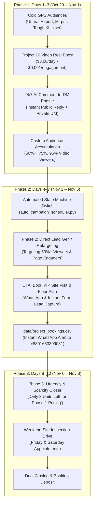

# 📅 10-Day Automated Meta Ads & Sales Funnel Execution Plan

> **Project**: Mollik Builders Ltd — Project 10 (Bashtola, Bhuiyan Bari, Dhaka)  
> **Campaign Duration**: October 29, 2026 – November 8, 2026 (10 Days)  
> **Total Budget**: \$30.00 USD (\$3.00/day)  
> **Ad Account ID**: `act_221651059226062`  
> **Target Asset**: 1570 sqft Luxury 3-Bed Flat (৳48,25,000 Total, 36 Months Installment)  
> **Automation Engine**: `auto_campaign_scheduler.py` + `local_dashboard.py` + `whatsapp_dispatcher.py`  
> **Owner Notification**: `+8801633309081` (FS Ferdows)

---

## 🏗️ 1. Executive Funnel Architecture

High-ticket real estate in Dhaka (৳48.25 Lakh) cannot be sold on cold clicks. This 10-day campaign uses an automated **3-Stage Sequential Retargeting Funnel** that algorithmically converts cold traffic into warmed viewers, then into phone-verified site visit bookings, and finally into signed purchase agreements.



---

## 🗓️ 2. Day-by-Day Master Automation Schedule

### Phase 1: Cold Audience Warming & 24/7 Comment Sales (Days 1–3: Oct 29 – Nov 1)
* **Goal**: Build massive local social proof, maximize video watch time at minimum cost, and capture early hand-raisers.
* **Daily Budget**: \$3.00 / day (\$9.00 total for Phase 1).
* **Ad Objective**: `POST_ENGAGEMENT` / Video Views (`act_221651059226062`).
* **Targeting**: Hyper-local 3km radius GPS pins around Uttara, Kawla/Airport, Mirpur, Tongi, and Khilkhet (Ages 30–55).
* **Automated Sales Actions**:
  - `comment_responder.py`: Continuously monitors reel comments. Whenever an inquiry appears (*"Price?"*, *"Details?"*, *"Location?"*), it sends a polite public response and triggers an instant private DM.
  - `sales_agent.py`: Engages the prospect in Messenger, shares project specs (1570 sqft, 3 bed, ৳12L land + ৳36.25L construction), and requests their phone number for WhatsApp site visit booking.
* **Expected Metrics**: 25,000+ impressions, 15,000+ video views, 1,000+ engagements, 20–35 Messenger conversation starts.

---

### Phase 2: Direct Lead Gen & Retargeting Launch (Days 4–7: Nov 2 – Nov 5)
* **Trigger Condition**: Automatically executed by `auto_campaign_scheduler.py` at **00:01 AM on November 2, 2026** (or once $\ge 5,000$ video viewers accumulate).
* **Goal**: Transform warmed video watchers into verified name-and-phone-number leads for in-person site visits.
* **Daily Budget**: \$3.00 / day (\$12.00 total for Phase 2).
* **Ad Objective**: `OUTCOME_LEADS` / Messenger Inquiries.
* **Audience**: **Custom Retargeting Audience**:
  1. Users who watched $\ge 50\%$ of the Project 10 Reel.
  2. Users who interacted with the Mollik Builders Facebook/Instagram page in the past 30 days.
  3. Exclude existing registered leads in `data/project_bookings.csv`.
* **Ad Hook & Copy (Retargeting)**:
  > **বাংলা**: "উত্তরা বাশতলায় প্রজেক্ট ১০-এর ভিডিওটি যারা দেখেছেন — এই শুক্র ও শনিবার সপরিবারে সাইট পরিদর্শনের জন্য আপনাকে স্বাগতম। সরাসরি সাইট ভিজিট করুন এবং পান বিশেষ প্রি-বুকিং ডিসকাউন্ট!"  
  > **Primary CTA**: *Book Site Visit* / *Send WhatsApp Message*.
* **Automated Sales Actions**:
  - Form/DM submissions trigger `whatsapp_dispatcher.py` to notify `+8801633309081` in under 3 seconds.
  - Automatically appends lead data to `data/project_bookings.csv`.
* **Expected Metrics**: 30–50 high-intent phone numbers at an estimated CPL of \$0.40 – \$0.90.

---

### Phase 3: Scarcity & Deal Closing Engine (Days 8–10: Nov 6 – Nov 8)
* **Trigger Condition**: Automatically executed by `auto_campaign_scheduler.py` at **00:01 AM on November 6, 2026**.
* **Goal**: Close warm prospects who visited or inquired before the 10-day promotional campaign terminates.
* **Daily Budget**: \$3.00 / day (\$9.00 total for Phase 3).
* **Ad Hook & Copy (Urgency / Deadline)**:
  > **বাংলা**: "প্রজেক্ট ১০ (বাশতলা): ফেজ-১ প্রি-বুকিং সুবিধার আর মাত্র ৩টি ফ্ল্যাট অবশিষ্ট আছে! ১০ নভেম্বরের মধ্যে সাইট ভিজিট ও বুকিং নিশ্চিত করলেই পাচ্ছেন বিশেষ কিস্তি সুবিধা ও পেনাল্টি রেন্ট গ্যারান্টি।"
* **Automated Actions**:
  - `send_csv_to_whatsapp.py`: Dispatches compiled final lead report to FS Ferdows.
  - Automated WhatsApp broadcast reminder to all warm leads for Friday/Saturday physical site inspections.
* **Expected Metrics**: 10–15 physical site visits, 1–3 signed booking tokens.

---

## ⚙️ 3. Automated State Machine (`auto_campaign_scheduler.py`)

The automated supervisor script tracks campaign progress and executes transitions without manual intervention:

```
[Cron / Background Daemon] 
       │
       ▼
 auto_campaign_scheduler.py
       │
       ├─► Read Current Date vs Start Date (2026-10-29)
       ├─► Inspect Live Ad Metrics via tools/browser_reach.py
       │
       ├── If Day 1–3:
       │    └─► Maintain Phase 1 (Video Boost & Comment-to-DM)
       │    └─► Verify daily spend is within $3.00 target
       │
       ├── If Day 4–7 (Nov 2):
       │    └─► Check if Phase 2 Campaign is deployed
       │    └─► Trigger deploy_phase2_retargeting()
       │    └─► Dispatch WhatsApp Transition Alert to Owner
       │
       └── If Day 8–10 (Nov 6):
            └─► Check if Phase 3 Scarcity Ad is active
            └─► Trigger deploy_phase3_scarcity()
            └─► Dispatch Final Leads CSV to WhatsApp
```

---

## 📊 4. Budget & KPI Milestone Scorecard

| Funnel Phase | Date Range | Daily Budget | Total Spend | Target Metric | Target Volume | Primary KPI |
| :--- | :--- | :--- | :--- | :--- | :--- | :--- |
| **Phase 1: Video Boost** | Oct 29 – Nov 1 | \$3.00 | \$9.00 | Video Views | 20,000+ views | \$0.001 per engagement |
| **Phase 2: Retargeting Leads**| Nov 2 – Nov 5 | \$3.00 | \$12.00 | Site Visit Leads | 35–50 verified phones | < \$0.80 per lead |
| **Phase 3: Scarcity Closer** | Nov 6 – Nov 8 | \$3.00 | \$9.00 | Site Inspections | 10–15 booked visits | 1–3 flat bookings |
| **Campaign Totals** | **10 Days** | **\$3.00/day** | **\$30.00** | **Total Pipeline** | **60–100 Qualified Leads** | **1 Sold Flat = ৳48,25,000** |

---

## 🛠️ 5. Operational Commands & CLI Reference

All monitoring is performed **without screenshots** using the customized `Agent-Reach` DOM bridge:

```bash
# 1. Check current campaign phase & live delivery
python3 auto_campaign_scheduler.py --status

# 2. Inspect live Meta Ads Manager metrics (0.3s DOM extraction)
python3 tools/browser_reach.py meta-ads

# 3. Simulate or dry-run Phase 2 Retargeting deployment
python3 auto_campaign_scheduler.py --dry-run-phase2

# 4. Trigger WhatsApp lead CSV export to +8801633309081
python3 send_csv_to_whatsapp.py

# 5. Access the Local AI Control Center
open http://localhost:5050
```
