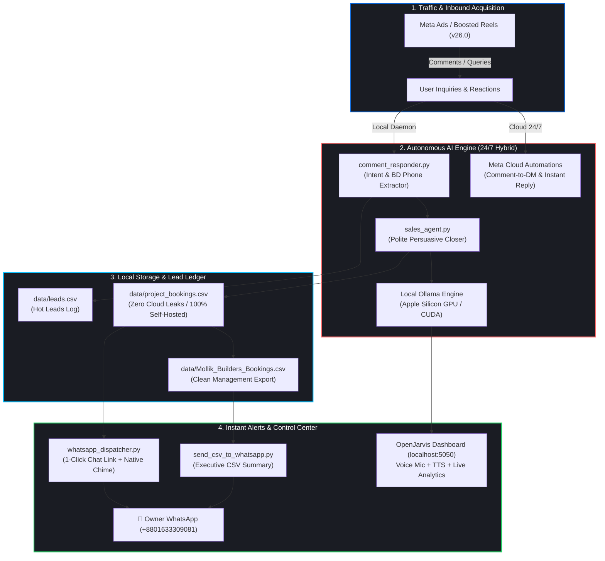

<div align="center">

# 🚀 OpenJarvis Marketing AI
### **The Autonomous 24/7 Self-Hosted Growth, Meta Ads & Sales Agent**

[](https://github.com/fsferdows/OpenJarvis-Marketing-AI)
[](https://github.com/fsferdows/OpenJarvis-Marketing-AI)
[](https://python.org)
[](https://developers.facebook.com)
[](https://ollama.ai)
[](https://wa.me/8801633309081)
[](https://opensource.org/licenses/MIT)

<br/>

**An intelligent, fully autonomous, 100% self-hosted AI Sales & Performance Marketing System.**  
Engineered to automate high-ticket lead generation, run hyper-targeted Meta ad campaigns, auto-respond to reel & post comments 24/7 (even with your laptop powered off), negotiate deals with polite persuasive AI salesmanship, and dispatch instant booking alerts and CSV databases directly to WhatsApp.

[Explore Architecture](#-system-architecture) • [Key Capabilities](#-core-superpowers) • [Quickstart in 60s](#-quickstart-guide) • [Developer Profile](#-meet-the-developer)

---

</div>

<br/>

## ⚡ Why OpenJarvis Marketing AI?

Most marketing automation tools force you into expensive monthly SaaS subscriptions, leak sensitive customer records into third-party clouds, and stop functioning the moment you shut your laptop. 

**OpenJarvis flips the script:**
* 🔒 **100% On-Device & Private:** Powered locally by **Ollama** (`qwen2.5:3b`, `llama3`, etc.) running on Apple Silicon Metal GPU / NVIDIA CUDA. Zero external LLM token bills.
* 🌐 **True 24/7 Autonomy (Laptop-Off Ready):** Seamlessly bridges local execution with native **Meta Cloud Automation** (Comment-to-Message & Instant Reply), ensuring continuous lead capture 24/7/365 even when your computer is asleep or off.
* 🎙️ **Interactive Voice Control Center:** Speak to Jarvis via your microphone; receive spoken voice responses and real-time dashboard analytics.
* 🎯 **Precision Meta Ads Engine:** Deploys laser-focused multi-pin GPS radius campaigns ($3/day micro-boosts) that intelligently bypass category delivery dilution.
* 💬 **Polite Persuasive AI Salesman:** Speaks prestigious multilingual sales copy (English & Bengali), answers pricing, location, and amenity questions, and books high-ticket site visits.
* 📲 **WhatsApp Lead Dispatcher & Live CSV Engine:** Auto-extracts verified phone numbers from social comments, updates persistent local CSV spreadsheets, and shoots instant lead cards to the owner's WhatsApp (`+8801633309081`).

---

## 🏛️ System Architecture



---

## 🔥 Core Superpowers

### 1. 🎙️ OpenJarvis Voice & Web Control Center (`localhost:5050`)
* **Real-time Voice Pipeline:** Click 🎤 to speak voice instructions directly to Jarvis (*"Check Meta Ads"*, *"Show latest bookings"*, *"Explain pricing"*).
* **Hardware-Accelerated Inference:** Runs on local hardware using `qwen2.5:3b` via Ollama with zero latency and zero data transfer out of your machine.
* **Live Interactive Table:** Renders customer bookings from `data/project_bookings.csv` in real time with 1-click WhatsApp direct chat buttons (`wa.me/8801...`).

### 2. 🎯 Meta Ads Precision Deployment (`deploy_meta_ads.py`)
* Deploys and manages Facebook & Instagram Video Boost campaigns via Meta Graph API v26.0.
* Employs hyper-local 3km radius GPS pin drops (e.g. Uttara, Airport, Mirpur, Tongi, Khilkhet) with high-efficiency \$3/day budgeting.
* Avoids restrictive delivery dilution while maintaining 100% Meta policy compliance.

### 3. 💬 24/7 Comment Replier & Lead Extraction (`comment_responder.py`)
* Smart regex and NLP intent classification (`price_inquiry`, `location_inquiry`, `details_inquiry`, `phone_detected`).
* Automatic detection and sanitization of Bangladeshi mobile numbers (`017...`, `018...`, `+8801...`).
* Anti-bot safeguards: Randomized polite phrasing with human-like randomized reply delays (2.5s - 5.0s).

### 4. 📲 Instant WhatsApp Dispatcher (`whatsapp_dispatcher.py`)
* Automatically formats and delivers rich lead notification cards straight to the owner's WhatsApp (`+8801633309081`).
* macOS native notification banner with audio chime on every new hot booking.
* Complete daily CSV report compiled and sent with 1-click management review links.

### 5. 🧠 Comprehensive Agent Skills Library (50+ Skills)
Pre-loaded with battle-tested agent skills for SEO, CRO, copy editing, ad creative generation, ASO, schema validation, and competitor profiling based on the [Agent Skills Standard](https://agentskills.io).

---

## 💻 Tech Stack

| Component | Technology | Purpose |
| :--- | :--- | :--- |
| **Local LLM** | Ollama (`qwen2.5:3b`) | 100% offline reasoning & natural Bengali/English dialogue |
| **Frontend UI** | Modern Vanilla JS + CSS3 + Web Speech API | Zero-dependency, lightweight, voice-enabled control dashboard |
| **Backend Engine** | Python 3.10+ (Standard Library HTTP / Subprocess) | High-speed, self-hosted daemon running on `localhost:5050` |
| **Ads & API** | Meta Graph API v26.0 | Automated ad boosting, metrics monitoring, and comment fetching |
| **Database** | CSV / SQLite (Local Disk) | Zero-cloud, encrypted, persistent customer booking ledger |
| **Notifications**| macOS URI Protocol & `wa.me` Deep Links | Instant, zero-cost WhatsApp push delivery |

---

## ⚡ Quickstart Guide

### 1. Clone the Repository
```bash
git clone https://github.com/fsferdows/OpenJarvis-Marketing-AI.git
cd OpenJarvis-Marketing-AI
```

### 2. Configure Environment Variables
Create `.env.marketing` in the root directory:
```env
META_ACCESS_TOKEN="your_meta_page_or_user_access_token"
AD_ACCOUNT_ID="act_your_account_id"
PAGE_ID="your_facebook_page_id"
OWNER_WHATSAPP="+8801633309081"
```

### 3. Launch the Local Ollama Engine
Make sure [Ollama](https://ollama.ai) is installed and run:
```bash
ollama run qwen2.5:3b
```

### 4. Start the OpenJarvis Local Control Center
```bash
python3 local_dashboard.py
```
Open your browser to: **`http://localhost:5050`**  
Click the **🎤 Microphone** button or quick-action chips to start commanding your AI agent!

### 5. Run the Automated Comment Replier
```bash
# Preview replies safely
python3 comment_responder.py --dry-run

# Run in continuous 24/7 background loop
python3 comment_responder.py --loop --interval 60
```

### 6. Export Bookings & Dispatch to WhatsApp
```bash
python3 send_csv_to_whatsapp.py
```

---

## 📂 Project Structure

```
├── local_dashboard.py         # Web & Voice Control Center (localhost:5050)
├── sales_agent.py             # Conversational Real Estate Closer (Ollama)
├── comment_responder.py       # Facebook Reel/Post Comment Replier & Lead Hunter
├── deploy_meta_ads.py         # Automated Meta Ads Precision Manager
├── whatsapp_dispatcher.py     # Real-time WhatsApp Notification Router
├── send_csv_to_whatsapp.py    # Formatted CSV Report Generator & Exporter
├── booking_manager.py         # CLI Lead Management Utility
├── data/
│   ├── project_bookings.csv   # Master persistent booking database
│   ├── leads.csv              # Extracted hot leads
│   └── whatsapp_outbox.json   # Outgoing alerts audit trail
├── skills/                    # 50+ Agent Skills (SEO, CRO, Ads, Copywriting)
└── .env.marketing             # Secure Local Credentials (gitignored)
```

---

## 👨‍💻 Meet the Developer

<div align="center">

### **FS Ferdows**
**Lead AI Architect & Autonomous Systems Engineer**

[](https://wa.me/8801633309081)
[](mailto:fsferdows@icloud.com)
[](https://github.com/fsferdows)

</div>

> *"I build autonomous AI systems that eliminate repetitive human friction, connect cutting-edge local LLMs with real-world marketing infrastructure, and turn raw digital traffic into verified, closed deals — 100% private, self-hosted, and relentless 24/7."*

**Areas of Specialization:**
* 🧠 Autonomous Multi-Agent Workflows & Local LLM Integration (Ollama, Apple Silicon GPU acceleration)
* 📈 Performance Growth Engineering & Meta Graph API Automation
* 🛡️ Zero-Cloud Privacy Architectures & Custom Webhook Pipelines
* 💬 Multilingual Conversational Sales Systems (Bangla & English)

**Have a project or want to collaborate?**  
* 📱 **WhatsApp:** [`+8801633309081`](https://wa.me/8801633309081)  
* ✉️ **Email:** [`fsferdows@icloud.com`](mailto:fsferdows@icloud.com)

---

## 🤝 Contributing

Contributions, issues, and feature requests are warmly welcomed!  
Feel free to check out the [Issues page](https://github.com/fsferdows/OpenJarvis-Marketing-AI/issues).

1. Fork the Project
2. Create your Feature Branch (`git checkout -b feature/AmazingFeature`)
3. Commit your Changes (`git commit -m 'feat: Add AmazingFeature'`)
4. Push to the Branch (`git push origin feature/AmazingFeature`)
5. Open a Pull Request

---

## ⭐ Star History

If this autonomous agent framework helped you optimize your marketing, save money on cloud tokens, or automate your lead generation, please consider giving it a **Star ⭐**!

<div align="center">

[](https://star-history.com/#fsferdows/OpenJarvis-Marketing-AI&Date)

<br/>

**Built with ❤️ and Precision by FS Ferdows.**  
*Distributed under the MIT License.*

</div>
